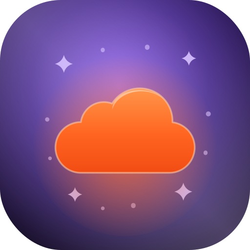
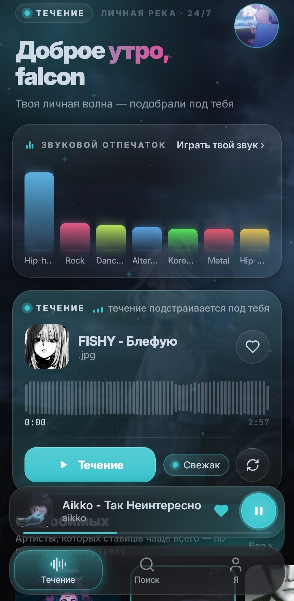
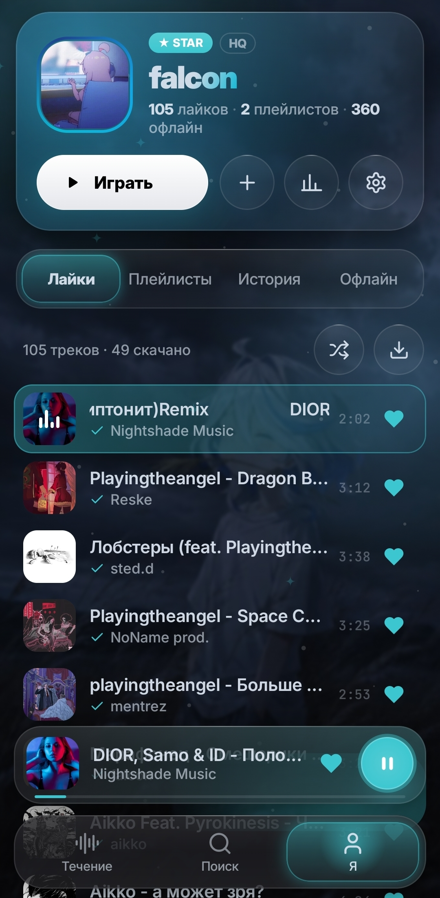
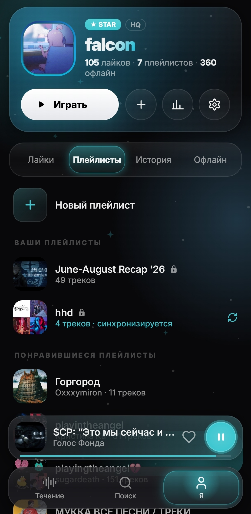

<p align="center">
<a href="../../README.md"></a>
<a href="README.en.md"></a>
<a href="README.be.md"></a>
<a href="README.zh.md"></a>
<a href="README.de.md"></a>
<a href="README.fr.md"></a>
<a href="README.es.md"></a>
<a href="README.tr.md"></a>
<a href="README.ko.md"></a>
</p>

<p align="center">
<a href="https://github.com/okeydw/SoundCloud-iOS/releases/latest">

</a>
</p>

<h1 align="center">SoundCloud iOS</h1>

<p align="center">
<b>[<a href="https://github.com/zxcloli666/SoundCloud-Desktop">Masaüstü sürümü</a>] · [<a href="https://github.com/okeydw/SoundCloud-Android">Android sürümü</a>]</b><br>
<b>iPhone ve iPad için resmi olmayan SoundCloud istemcisi</b><br>
Reklamsız · Captcha yok · Sansür yok · Rusya'da kullanılabilir
</p>

<p align="center">
<a href="https://github.com/okeydw/SoundCloud-iOS/releases/latest">

</a>

<a href="https://github.com/okeydw/SoundCloud-iOS/releases">

</a>

<a href="../../LICENSE">

</a>
</p>

<p align="center">
<a href="https://github.com/okeydw/SoundCloud-iOS/releases/latest">

</a>
</p>

---

## Bu nedir?

**SoundCloud iOS**, iPhone ve iPad için yerel bir SoundCloud istemcisidir. [SoundCloud-Desktop](https://github.com/zxcloli666/SoundCloud-Desktop) ile senkronizedir.

**Kotlin + Compose Multiplatform** ile yazıldı, masaüstü sürümü tarzında Glass arayüze sahip. Şu an beta aşamasında.

---

## İndir

[Sürümler sayfasına](https://github.com/okeydw/SoundCloud-iOS/releases/latest) git ve ihtiyacın olan dosyayı indir:

| Dosya | Kurulum aracı |
| --- | --- |
| `SoundCloud-iOS-vX.Y.Z.tipa` | TrollStore |
| `SoundCloud-iOS-vX.Y.Z.ipa` | AltStore, SideStore, Sideloadly |

**Gereksinimler:** iOS 15.0 veya daha yeni. Derleme Apple sertifikasıyla imzalı değil, bu yüzden yalnızca bu araçlarla kurulur.

**Nasıl kurulur:** adım adım kılavuz [burada](https://docs.getsoundcloud.app/install/ios).

**iOS'ta henüz yok:** içe aktarma, ekolayzır, SoundCloud Auto, ses çıkışı seçimi ve uygulama içi güncelleme.

---

## Nasıl giriş yapılır

Ardından giriş gelir: SoundCloud üzerinden ya da masaüstü sürümündeki QR kodla.

1. **Masaüstünden QR (önerilen).** [SoundCloud-Desktop](https://github.com/zxcloli666/SoundCloud-Desktop) içinde Ayarlar -> Hesap -> Oturumu başka cihaza aktar bölümünü aç, ardından QR kodu tara.
2. **Telefondan QR.** Giriş ekranında "Giriş için QR göster"e dokun ve zaten giriş yaptığın yerde tara.
3. **Tarayıcı ile.** "Tarayıcı ile giriş yap" düğmesi normal SoundCloud girişini açar. Daha sonra başka bir yerde giriş yaparsan bu oturum düşebilir.

---

## Ekran görüntüleri

> Arka plan, vurgu ve metin renkleri RGB paletiyle değiştirilebilir. Arka plan resmi ve efektler de eklenebilir.

<p align="center">



</p>
<p align="center">



</p>

---

## Özellikler

### Müzik

- **Dalga ve öneriler** - beğenilere ve dinleme geçmişine dayanan kendi öneri sistemimiz
- **Arama** - parçalar, sanatçılar, çalma listeleri, albümler ve vibe araması (bir sinir ağı bağlama göre parça seçer)
- **Oynatıcı** - karıştırma, tekrar, sıra, şarkı sözleri, beğeni ve beğenmeme
- **Çalma listeleri** - SoundCloud ile senkronize kendi yerel listelerin, herkese açık veya gizli, parça sırası sürükleyerek değişir ve kaydedilir
- **Geçmiş ve istatistikler** - dinleme süresi, en çok dinlenen parçalar ve sanatçılar, günlere ve saatlere göre grafik
- **Profiller** - takip etme ve takibi bırakma, SoundCloud profilindeki bağlantılar

### Çevrimdışı mod

- Parça ve çalma listesi indirme, önbellekli çevrimdışı mod

---

## Geri bildirim
Topluluk: [Discord](https://discord.gg/Au3ebtfYu3)

Bir hata buldun ya da bir fikrin mi var? En kolayı "Ayarlar -> Sistem hakkında -> iOS uygulaması desteği" ya da Discord'da destek talebi. İstersen doğrudan [issue açıp](https://github.com/okeydw/SoundCloud-Android/issues/new/choose) günlükleri ekleyebilirsin: "Ayarlar -> Günlükler -> Kopyala".

---

## Teknolojiler

| Katman | Teknolojiler |
| --- | --- |
| Dil | Kotlin |
| UI | Compose Multiplatform, Haze (cam efekti) |
| Ses | AVFoundation, arka planda çalma ve kilit ekranı kontrolleri |
| Ağ | NSURLSession, kotlinx.serialization |
| Görseller | Coil 3 |
| Kamera | AVFoundation (QR tarayıcı) |
| Depolama | NSUserDefaults (ayarlar, oturum), indirmeler ve listeler için JSON dizinleri |

Backend: [SoundCloud-Backend](https://github.com/zxcloli666/SoundCloud-Backend).

Sunucu durumu [burada](https://status.soundcloud-desktop.fun/)

**Uyumluluk:** iOS 15.0 veya daha yeni, iPhone ve iPad.

Tüm değişiklikler [CHANGELOG.md](../../CHANGELOG.md) dosyasında.

---

## Geliştiriciler için

**Derleme:** macOS, Xcode, JDK 17, [XcodeGen](https://github.com/yonaskolb/XcodeGen).

```bash
./gradlew :core:compileKotlinIosArm64 :ui:compileKotlinIosArm64   # ortak kod iOS için derleniyor mu
cd iosApp && xcodegen generate                                    # project.yml'den Xcode projesi
open SoundCloud.xcodeproj                                         # Kotlin framework'ü kendiliğinden derlenir
```

**Kaynak kod:**

| Klasör | İçerik |
| --- | --- |
| `core/src/commonMain` | ortak mantık: API, oynatıcı, indirmeler, listeler |
| `core/src/iosMain` | iOS: AVFoundation oynatıcı, ağ, indirmeler, depolama |
| `ui/src/commonMain` | Glass arayüzü |
| `ui/src/iosMain` | iOS: ayarlar, QR tarayıcı, giriş noktası |
| `iosApp` | Xcode projesi (XcodeGen) |

**Sürüm:** `vX.Y.Z` etiketi (`app/build.gradle.kts` içindeki `versionName` ile aynı olmalı) imzasız `.ipa` ve `.tipa` dosyalarını derler ve sürümde yayınlar. Sürümsüz test derlemesi için `iOS` iş akışı Actions'ta elle ya da mesajında `[ipa]` olan bir commit ile çalışır.

**Backend:**

| Alan adı | Amaç |
|---|---|
| `api.scnative.space`, `api-star.scnative.space` | API |
| `stream.scnative.space`, `stream-star.scnative.space` | ses |
| `storage.scnative.space`, `storage-star.scnative.space`, `s3.scnative.space` | parça deposu |
| `images.scnative.space` | kapaklar |
| `pay.scnative.space` | STAR ödemesi |
| `health.scnative.space` | bağlantı kontrolü |
| `call-*.scnative.space` | "Kullanıcı ağı" |
| `*.relay.scnative.space` | yedek rotalar |
| `soundcloud.com`, `api-v2.soundcloud.com`, `*.sndcdn.com` | parçayı doğrudan SoundCloud'dan indirme |

QR ile giriş protokolü: masaüstü deposundaki [qr-link-protocol.md](https://github.com/zxcloli666/SoundCloud-Desktop/blob/main/docs/qr-link-protocol.md).

---


## Lisans

MIT. Ayrıntılar [LICENSE](../../LICENSE) dosyasında.

_SoundCloud, SoundCloud Ltd.'nin ticari markasıdır. Bu uygulamanın SoundCloud ile bir bağlantısı yoktur._

---

<p align="center">
<a href="https://github.com/okeydw/SoundCloud-iOS/releases/latest">

</a>
</p>

<p align="center">
<code>soundcloud ios</code> · <code>soundcloud iphone</code> · <code>soundcloud ipa</code> · <code>soundcloud ipad</code> · <code>soundcloud trollstore</code> · <code>soundcloud istemcisi</code> · <code>reklamsız soundcloud</code> · <code>soundcloud engellendi</code> · <code>soundcloud çalışmıyor</code> · <code>soundcloud alternative client</code> · <code>soundcloud no ads</code>
</p>
